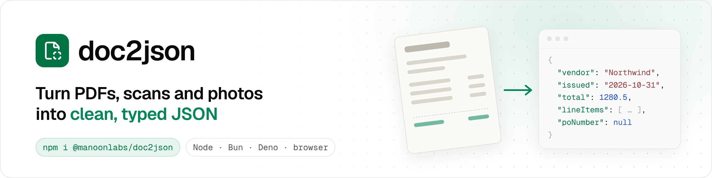
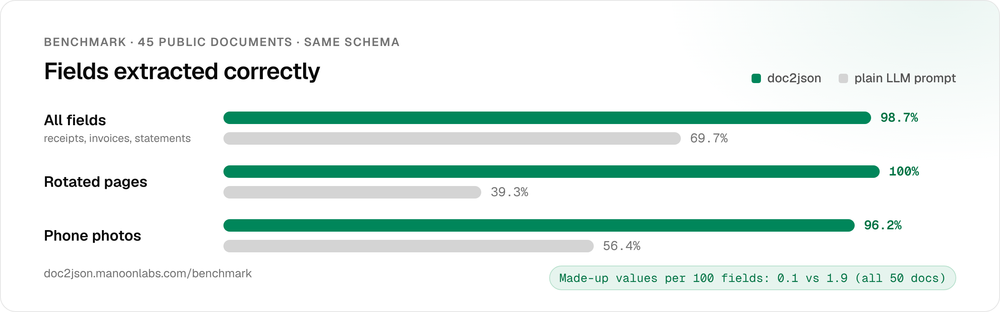
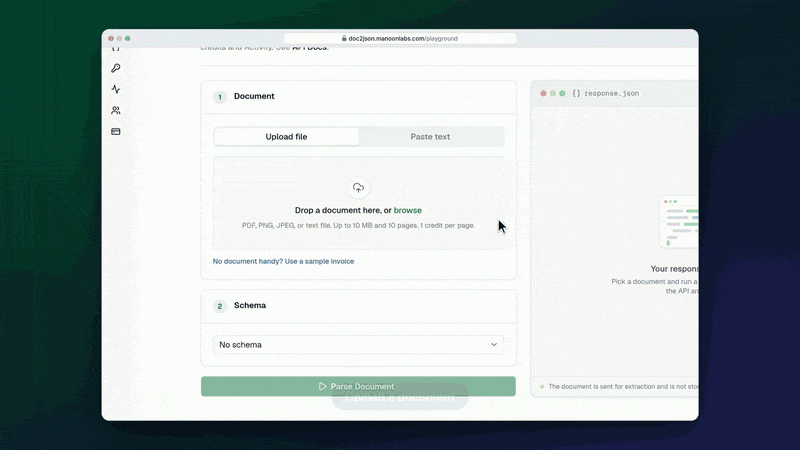
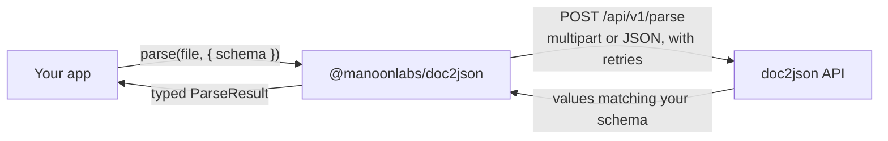

<p align="center">
  
</p>

<p align="center">
  <a href="https://www.npmjs.com/package/@manoonlabs/doc2json"></a>
  <a href="https://github.com/manoonlabs/doc2json-js/actions/workflows/ci.yml"></a>
  <a href="./LICENSE"></a>
  
  
  
</p>

<p align="center">
  <a href="https://doc2json.manoonlabs.com/sign-up"><b>Get an API key</b></a> ·
  <a href="https://doc2json.manoonlabs.com/docs">API docs</a> ·
  <a href="https://doc2json.manoonlabs.com/playground">Playground</a> ·
  <a href="https://doc2json.manoonlabs.com/docs/mcp">MCP server</a> ·
  <a href="https://doc2json.manoonlabs.com/benchmark">Benchmark</a>
</p>

The official JavaScript and TypeScript SDK for [doc2json](https://doc2json.manoonlabs.com). Send a PDF, scan, phone photo or text, plus the schema you want. Get back JSON in that shape. If a field isn't on the document, you get `null`, not a guess.

```ts
import { Doc2Json } from "@manoonlabs/doc2json";

const doc2json = new Doc2Json(); // reads DOC2JSON_API_KEY
const { values } = await doc2json.parse("invoice.pdf", { schema: "invoice" });
```

## Contents

- [Why doc2json](#why-doc2json)
- [Benchmark](#benchmark)
- [How it works](#how-it-works)
- [Install](#install)
- [Quick start](#quick-start)
- [Inputs](#inputs)
- [Schemas](#schemas)
- [Excel and CSV export](#excel-and-csv-export)
- [Credits and identity](#credits-and-identity)
- [Error handling](#error-handling)
- [Retries, timeouts and cancellation](#retries-timeouts-and-cancellation)
- [Options](#options)
- [Runtime support](#runtime-support)
- [MCP and the web app](#mcp-and-the-web-app)
- [Pricing](#pricing)
- [Development](#development)
- [License](#license)

## Why doc2json

- **It copes with messy input.** Rotated pages, phone photos, scanned receipts and multi-page PDFs. That's where a plain LLM prompt starts guessing.
- **The schema drives the output.** You define the fields once, as a saved schema or inline. Every response matches that shape, and arrays are always arrays.
- **Typed end to end.** Pass a Zod schema and `values` is typed from it, or use `parse<T>()` for `values: T`. Errors come back as classes you can `instanceof`.
- **Zero runtime dependencies.** The only package it asks for is `zod` as a peer, for Zod schemas. It's built on native `fetch` and `FormData`, ships as ESM and CommonJS, and runs on Node 18+, Bun, Deno and in the browser.
- **One API in three places.** Use it over REST (this SDK), as an MCP server for AI agents and editors, or in the web app.

## Benchmark

We ran doc2json and a plain LLM prompt over **45 public documents with the same schema**, then scored every field against a hand-checked answer key.

<p align="center">
  
</p>

| Fields extracted correctly                  |  doc2json | Plain LLM prompt |
| ------------------------------------------- | --------: | ---------------: |
| All fields                                  | **98.7%** |            69.7% |
| Rotated pages                               |  **100%** |            39.3% |
| Phone photos                                | **96.2%** |            56.4% |
| Made-up values per 100 fields (all 50 docs) |   **0.1** |              1.9 |

The method, caveats and per-document CSV are on the [benchmark page](https://doc2json.manoonlabs.com/benchmark).

<!--
  Citations demo: uncomment once citations are live in production.
  <p align="center">
    
  </p>
-->

## How it works



The SDK turns your input into the right request body. Files, bytes and paths are sent as `multipart/form-data`; base64 and text are sent as JSON. It adds your key, retries transient failures and returns typed results. The file isn't stored. The bytes are dropped after the request.

## Install

```sh
npm install @manoonlabs/doc2json
# or
pnpm add @manoonlabs/doc2json
yarn add @manoonlabs/doc2json
bun add @manoonlabs/doc2json
```

On Deno, import `npm:@manoonlabs/doc2json`.

`zod` (version 4) is a peer dependency, used only when you pass a [Zod schema](#zod-schemas). npm 7 and later and pnpm install it for you. On Yarn, run `yarn add zod` if you want Zod schemas. Plain schemas work without it.

## Quick start

1. [Sign up](https://doc2json.manoonlabs.com/sign-up) and create a key on the [API Keys](https://doc2json.manoonlabs.com/apikeys) page. The full secret is shown once.
2. Put the key in your environment:

   ```sh
   export DOC2JSON_API_KEY=bk_live_...
   ```

3. Parse a document:

   ```ts
   import { Doc2Json } from "@manoonlabs/doc2json";

   const doc2json = new Doc2Json({ apiKey: process.env.DOC2JSON_API_KEY });

   const result = await doc2json.parse("invoice.pdf", { schema: "invoice" });

   console.log(result.values); // the extracted JSON
   console.log(result.credits_used, result.credits_remaining);
   ```

If you leave out `apiKey`, the client reads `DOC2JSON_API_KEY` from the environment. If there's no key at all, the constructor throws a `Doc2JsonError` with code `missing_api_key`.

Want to see the output before writing code? Run a sample invoice in the [Playground](https://doc2json.manoonlabs.com/playground). No sign-in needed.

## Inputs

`parse()` takes the document in whatever form you have it:

```ts
import { readFile } from "node:fs/promises";

// A file path (Node, Bun and Deno)
await doc2json.parse("./invoice.pdf");

// Bytes: Buffer, Uint8Array or ArrayBuffer
await doc2json.parse(await readFile("invoice.pdf"), { filename: "invoice.pdf" });

// A Blob or File, for example from an <input type="file">
await doc2json.parse(input.files[0]);

// Base64 (a data: URL prefix is removed for you)
await doc2json.parse({ base64: pdfBase64, filename: "invoice.pdf" });

// Plain text, such as an invoice email
await doc2json.parse({ text: "Invoice INV-1042 from Northwind Supply. Total 1280.50 USD." });
```

- **Formats:** PDF, PNG, JPEG and UTF-8 text files work. The type is read from the file bytes, not the name.
- **Limits:** on the Free plan, documents can be up to 10 MB and 10 pages. Paid plans allow 25 MB and 50 pages. A document over the page limit is refused before any credit is spent.
- **Filename:** this sets the document name used in your activity log and in export file names. It defaults to the file's own name.

## Schemas

Without a schema, doc2json chooses the fields. To control the output, pass the name of a schema saved in your workspace, or a definition for this call only:

```ts
type Invoice = {
  vendor: string | null;
  total: number | null;
  issued: string | null; // yyyy-mm-dd
  lineItems: { description: string; amount: number }[];
};

const result = await doc2json.parse<Invoice>("invoice.pdf", {
  schema: {
    type: "object",
    properties: {
      vendor: { type: "string" },
      total: { type: "number" },
      issued: { type: "date" },
      lineItems: {
        type: "array",
        items: {
          type: "object",
          properties: {
            description: { type: "string" },
            amount: { type: "number" },
          },
          required: ["description", "amount"],
        },
      },
    },
    required: ["vendor", "total"],
  },
});

result.values.total; // number | null
```

- **Field types:** `string`, `number`, `boolean`, `date`, `array`, `object`, `null` and `any`.
- **Dates:** a `date` comes back as `yyyy-mm-dd`.
- **Hints:** add a `description` to any field to tell doc2json how to read it.
- **Missing values:** a value that isn't on the document is `null`.
- **Arrays:** an array field is always an array, and `[]` when there are no rows.

### Zod schemas

Already using [Zod](https://zod.dev)? Pass a Zod 4 schema and skip both the JSON and the generic. The SDK converts it for you, and `values` is typed with `z.infer`:

```ts
import { z } from "zod";

const Invoice = z.object({
  vendor: z.string().nullable(),
  total: z.number().nullable(),
  issued: z.iso.date().nullable(), // yyyy-mm-dd
  lineItems: z.array(z.object({ description: z.string(), amount: z.number() })),
});

const result = await doc2json.parse("invoice.pdf", { schema: Invoice });

result.values.total; // number | null
result.validation.success; // true when values match Invoice
```

- **Install:** `zod` is a peer dependency. npm 7 and later install it with the SDK, so there's usually nothing to do. Plain JSON schemas still work with zero setup.
- **Use `.nullable()`** on any field that might not be on the document. doc2json returns `null` for a missing value, and `.nullable()` keeps your types honest.
- **Validation:** with a Zod schema, the result also has `validation`, which is `schema.safeParse(values)`. A mismatch never throws. Check `validation.success`, and read `validation.error.issues` for the details. `values` is always the JSON the API sent, so read `validation.data` if your schema uses transforms or `z.coerce`.
- **Hints:** `.describe("...")` becomes the field `description`.
- **Mapping:** `z.string()`, `z.number()` (and `.int()`), `z.boolean()` and `z.object()` map to the same doc2json types. `z.iso.date()` becomes `date`, sent back as a `yyyy-mm-dd` string. An enum becomes a `string` with the allowed values added to the hint, and a literal becomes its own type. `.optional()` drops the key from `required`. Shapes with no doc2json type, such as a union of two types, `z.record()` or `z.unknown()`, become `any`. Checks like `.min()` or `.regex()` aren't sent, but `validation` still applies them.
- **Dates as `Date`:** `z.date()` also becomes `date`, but the API still sends a string. Use `z.coerce.date()` and read `validation.data` to get a `Date`.
- **Saved schemas:** `schemas.create()` and `schemas.update()` take a Zod schema too.
- **See the result:** `zodToSchema(Invoice)` returns the definition the SDK sends.
- `zod/mini` schemas work too. Zod 3 schemas don't, so upgrade to `zod@4`.

### Saved schemas

Save a schema once and refer to it by name from every app, key and MCP client in the workspace:

```ts
await doc2json.schemas.create({ name: "invoice", schema });
await doc2json.schemas.list(); // [{ id, name, keyCount, createdAt, updatedAt }]
await doc2json.schemas.get("invoice"); // also includes .schema, the definition
await doc2json.schemas.update("invoice", { newName: "invoice-v2", schema });
```

You can also build schemas visually in the [schema editor](https://doc2json.manoonlabs.com/schemas).

## Excel and CSV export

Set `export` to get a spreadsheet next to the JSON from the same parse:

```ts
import { writeFile } from "node:fs/promises";

const result = await doc2json.parse("invoice.pdf", { schema: "invoice", export: "xlsx" });

result.values; // the JSON is always returned
if (result.export) await writeFile(result.export.filename, result.export.data);
```

| Field                | What it is                                    |
| -------------------- | --------------------------------------------- |
| `export.format`      | `"xlsx"` or `"csv"`                           |
| `export.filename`    | A suggested name, `<name>-<yyyy-mm-dd>.<ext>` |
| `export.data`        | The decoded file as a `Uint8Array`            |
| `export.content`     | The original base64 from the API              |
| `export.contentType` | The MIME type                                 |

## Credits and identity

```ts
const result = await doc2json.parse("invoice.pdf");
result.credits_used; // 1
result.credits_remaining; // 49

await doc2json.whoami(); // { workspaceId, tokenId, credits_remaining }
```

`whoami()` confirms that a key works and shows the credits left this month. It doesn't spend anything.

## Error handling

Every error extends `Doc2JsonError`, which has these fields:

- `status`;
- `code`, a stable string such as `rate_limited`;
- `message`;
- `requestId`, when the server sent one;
- `body` and `headers`.

```ts
import {
  AuthenticationError,
  Doc2JsonError,
  InsufficientCreditsError,
  RateLimitError,
  ValidationError,
} from "@manoonlabs/doc2json";

try {
  await doc2json.parse("invoice.pdf", { schema: "invoice" });
} catch (error) {
  if (error instanceof ValidationError) console.error("Bad request:", error.message);
  else if (error instanceof AuthenticationError) console.error("Check your API key");
  else if (error instanceof InsufficientCreditsError)
    console.error("Out of credits:", error.upgrade);
  else if (error instanceof RateLimitError) console.error(`Retry in ${error.retryAfter}s`);
  else if (error instanceof Doc2JsonError) console.error(error.code, error.message);
  else throw error;
}
```

| Class                      | When                                                                                                                                            |
| -------------------------- | ----------------------------------------------------------------------------------------------------------------------------------------------- |
| `ValidationError`          | 400 or 422: bad input, an unknown schema, or too many pages. Has `pages` and `maxPages` when the document was over the limit. Nothing is spent. |
| `AuthenticationError`      | 401: the key is missing, unknown, revoked or expired.                                                                                           |
| `InsufficientCreditsError` | 402: not enough credits. Has `creditsRequired` and `upgrade`.                                                                                   |
| `PermissionDeniedError`    | 403: parsing is paused for the workspace.                                                                                                       |
| `NotFoundError`            | 404: the schema wasn't found.                                                                                                                   |
| `ConflictError`            | 409: the schema name is taken, or the schema limit is reached.                                                                                  |
| `RateLimitError`           | 429: you sent more than one parse per second per workspace. Has `retryAfter`. Nothing is spent.                                                 |
| `InternalServerError`      | 5xx: the parse failed or timed out. The charge is refunded.                                                                                     |
| `APIError`                 | Any other error status. This is the base class of all the classes above.                                                                        |
| `APIConnectionError`       | No response came back: a network, DNS or TLS failure.                                                                                           |
| `APITimeoutError`          | The request took longer than `timeout`.                                                                                                         |
| `APIUserAbortError`        | You aborted the request with `signal`.                                                                                                          |

API errors also carry `creditsUsed` and `creditsRemaining` when the server sends them.

## Retries, timeouts and cancellation

- **Retried by default:** requests that fail with 408, 429, 5xx or a network error are retried twice, with jittered exponential backoff.
- **Retry timing:** a `Retry-After` header, or `retry_after` in the body, is honoured.
- **Not retried:** `schemas.create()`, so you never get a duplicate.

```ts
const doc2json = new Doc2Json({
  timeout: 120_000, // ms per attempt, the default
  maxRetries: 2, // the default
});

const controller = new AbortController();
await doc2json.parse("invoice.pdf", {
  signal: controller.signal,
  timeout: 60_000, // override for this call
  maxRetries: 0,
});
```

## Options

**Client options** (`new Doc2Json(options)`):

| Option       | Default                           | Description                                 |
| ------------ | --------------------------------- | ------------------------------------------- |
| `apiKey`     | `process.env.DOC2JSON_API_KEY`    | Your API key                                |
| `baseUrl`    | `https://doc2json.manoonlabs.com` | API origin                                  |
| `timeout`    | `120000`                          | Milliseconds per attempt                    |
| `maxRetries` | `2`                               | Retries on 408, 429, 5xx and network errors |
| `fetch`      | global `fetch`                    | A custom fetch, for proxies or tests        |

**Per-call options** (`parse(input, options)`):

| Option       | Type                                    | Description                                                                |
| ------------ | --------------------------------------- | -------------------------------------------------------------------------- |
| `schema`     | `string \| SchemaDefinition \| ZodType` | A saved schema name, an inline definition, or a [Zod schema](#zod-schemas) |
| `export`     | `"xlsx" \| "csv"`                       | Also return a spreadsheet                                                  |
| `filename`   | `string`                                | Document name. Defaults to the file's own name                             |
| `signal`     | `AbortSignal`                           | Cancel the request                                                         |
| `timeout`    | `number`                                | Override the client timeout                                                |
| `maxRetries` | `number`                                | Override the client retry count                                            |

`signal`, `timeout` and `maxRetries` also work on `whoami()` and every `schemas.*` method.

## Runtime support

| Runtime  | Supported                                             |
| -------- | ----------------------------------------------------- |
| Node.js  | 18 and later                                          |
| Bun      | Yes                                                   |
| Deno     | Yes, via `npm:@manoonlabs/doc2json`                   |
| Browsers | Yes, with `Blob`, `File`, bytes, base64 or text input |

File paths are read with `node:fs`, which is only loaded when you pass a path, so browser bundles stay clean.

> [!WARNING]
> Don't ship a secret API key to untrusted browsers. Call doc2json from your server, or use a key you're happy to share.

## MCP and the web app

The SDK covers the REST API. The same parsing is also available in two other places:

- **[MCP server](https://doc2json.manoonlabs.com/docs/mcp):** connect Cursor or any other MCP client to `https://doc2json.manoonlabs.com/mcp`, using your API key as a bearer token.
- **[Web app](https://doc2json.manoonlabs.com/playground):** this has the Playground, the visual schema editor, API keys and an activity log.

## Pricing

There's a Free plan with 50 credits a month and no card needed. One credit is one page, an image counts as one page, and plain text costs one credit per 3,000 characters. You're only charged when extraction succeeds. See [pricing](https://doc2json.manoonlabs.com/pricing) for the paid plans.

## Development

```sh
npm install
npm run build      # tsup: ESM, CJS and .d.ts into dist/
npm test           # vitest
npm run typecheck
npm run lint       # biome
```

The main example is [`examples/basic.ts`](./examples/basic.ts). Changes are listed in [CHANGELOG.md](./CHANGELOG.md), and you can report a security issue through [SECURITY.md](./SECURITY.md). Bugs and feature requests go to [GitHub Issues](https://github.com/manoonlabs/doc2json-js/issues).

## License

[MIT](./LICENSE), Copyright (c) 2026 ManoonLabs
